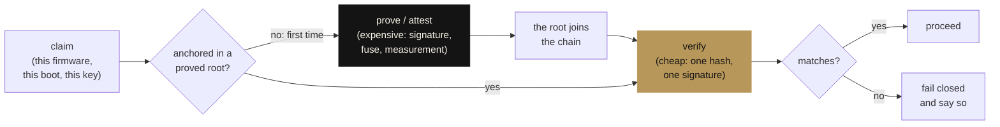

<div align="center">

[Português](README.md) · **English**

<picture>
  <source media="(prefers-color-scheme: dark)" srcset="docs/assets/banner-escuro.svg">
  <source media="(prefers-color-scheme: light)" srcset="docs/assets/banner-claro.svg">
  
</picture>

# Hardware security

**Security is verification. Trust is not assumed — it is verified, and verifying is cheap once the root has been proved expensively once. Ten principles and six labs you run, break and fix.**

[](tests)
[](requirements.txt)
[](labs)
[](https://github.com/thiagopatzdorf/james-theorems)
[](LICENSE)

[Manifesto](MANIFESTO.md) ·
[Labs](labs) ·
[james-theorems, the formal base](https://github.com/thiagopatzdorf/james-theorems)

</div>

---

## The problem in one picture

A system that has to **trust again every time** never becomes secure: each decision starts from zero. The opposite bet, the same one in [`james-theorems`](https://github.com/thiagopatzdorf/james-theorems), is to pay expensively **once** to establish the root, and from then on only **verify**, cheaply:



Generating the proof (signing an image, burning a fuse, measuring the boot) is expensive and stays with whoever builds. Verifying (checking a hash, validating a signature) costs microseconds and runs on every boot. It is the `O(n) → O(1)` of security: **the cost per decision tends to the cost of checking**. Everything here is an instance of that single idea.

## The thesis

Hardware security looks like a pile of physical topics — TPM, UEFI, USB, DMA, stack canaries. It is not. It is **one** claim, repeated at different scales:

> **Software trusts hardware; and hardware deserves trust only when it can be verified from a root that cannot be altered.**

The physical topics are where that claim touches the world. The boot chain is the root of trust propagated by signature. The TPM is the same root, measuring instead of blocking. The side channel is verification leaking through what is not in the spec. The stack canary is the hardware verifying memory integrity at runtime. **One principle, many instances** — which is why, once you grasp the abstraction, each new device is just another case.

## Run it yourself

No lab needs a TPM, a special board, or root. Where real hardware exists the code uses it; where it does not, it says so instead of pretending.

```bash
git clone https://github.com/thiagopatzdorf/seguranca-de-hardware && cd seguranca-de-hardware
python3 -m venv .venv && . .venv/bin/activate
pip install -r requirements.txt
pytest -q                        # 28 tests, seconds, no special hardware
python3 ferramentas/avaliar.py   # your machine's security score (Linux)
```

## The labs

Each is the thesis at one scale: chain of trust, timing side channel, TPM attestation, USB/BadUSB, firmware integrity, memory defenses, and the machine evaluator. Details in [`labs/`](labs) (in Portuguese).

## The formal base

The core idea — discovery is expensive, verification is cheap, and the per-item cost tends to the cost of checking — is **proved in Lean 4** in [`james-theorems`](https://github.com/thiagopatzdorf/james-theorems) (`amortizacao`). This repository is the same idea applied to hardware security: less formal, more concrete, runnable with no special hardware. The visual identity is generated by code ([`docs/assets/gerar.py`](docs/assets/gerar.py)) and is generative: `--seed` gives a different layout each time.

## Cite · License

Metadata in [`CITATION.cff`](CITATION.cff). License: [MIT](LICENSE).
