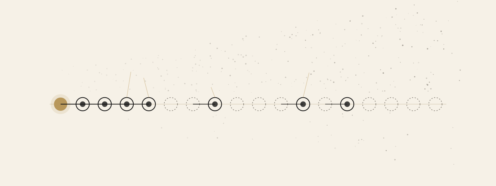
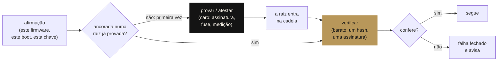

<div align="center">

**Português** · [English](README.en.md)

<picture>
  <source media="(prefers-color-scheme: dark)" srcset="docs/assets/banner-escuro.svg">
  <source media="(prefers-color-scheme: light)" srcset="docs/assets/banner-claro.svg">
  
</picture>

# Segurança de hardware

**Segurança é verificação. Confiança não se assume — se verifica, e verificar é barato quando a raiz foi provada cara uma vez. Dez princípios e seis laboratórios que você roda, quebra e conserta.**

[](tests)
[](requirements.txt)
[](labs)
[](https://github.com/thiagopatzdorf/james-theorems)
[](LICENSE)

[Manifesto](MANIFESTO.md) ·
[Princípios](PRINCIPIOS.md) ·
[Laboratórios](labs) ·
[Trilha](TRILHA.md) ·
[james-theorems, a base formal](https://github.com/thiagopatzdorf/james-theorems)

</div>

---

## O problema em uma imagem

Um sistema que precisa **confiar de novo a cada vez** nunca fica seguro: cada decisão recomeça do zero. A aposta oposta, a mesma do [`james-theorems`](https://github.com/thiagopatzdorf/james-theorems), é pagar caro **uma vez** para estabelecer a raiz, e dali em diante só **verificar**, barato:



Gerar a prova (assinar uma imagem, queimar um *fuse*, medir o boot) é caro e fica com quem constrói. Verificar (conferir um hash, validar uma assinatura) custa microssegundos e roda em toda inicialização. É o `O(n) → O(1)` da segurança: **o custo por decisão tende ao custo de conferir**. Tudo neste repositório é instância dessa única ideia.

## I. Tese

A segurança de hardware parece um amontoado de assuntos físicos — TPM, UEFI, USB, DMA, canários de pilha. Não é. É **uma** afirmação, repetida em escalas diferentes:

> **Software confia em hardware; e hardware só merece confiança quando pode ser verificado a partir de uma raiz que não se pode alterar.**

Os assuntos físicos são onde essa afirmação encosta no mundo. A cadeia de boot é a raiz de confiança propagada por assinatura. O TPM é a mesma raiz, mas medindo em vez de impedir. O canal lateral é a verificação vazando pelo que não está na especificação. O canário de pilha é o hardware verificando a integridade da memória em tempo de execução. **Um princípio, muitas instâncias** — e é por isso que, quando você entende a abstração, cada aparelho novo é só mais um caso.

## II. Os princípios

Dez, cada um com o ataque que impede, em [`PRINCIPIOS.md`](PRINCIPIOS.md). Os cinco que sustentam o resto:

| # | princípio | a abstração por trás |
|---|---|---|
| 1 | toda confiança começa em algo que não pode ser alterado | a raiz provada cara, uma vez |
| 2 | verificar é mais barato que gerar | o lado barato roda sempre; o caro, nunca mais |
| 3 | medir não é impedir | duas verificações: a que recusa e a que registra |
| 4 | o hardware vaza pelo que não está na especificação | a verificação como canal lateral |
| 10 | falhe fechado, e diga que falhou | o que não se pode verificar não vira confiança |

## III. Verifique você mesmo

Nenhum laboratório exige TPM, placa especial ou root. Onde o hardware real existe, o código o usa; onde não, diz que não existe, em vez de fingir.

```bash
git clone https://github.com/thiagopatzdorf/seguranca-de-hardware && cd seguranca-de-hardware
python3 -m venv .venv && . .venv/bin/activate
pip install -r requirements.txt
pytest -q                        # 28 testes, segundos, sem hardware especial
python3 ferramentas/avaliar.py   # a nota de segurança da máquina em que você está (Linux)
```

## IV. Os laboratórios

Cada um é a tese numa escala. Roda, quebra e conserta.

| lab | a instância | o que você vê |
|---|---|---|
| [`01-cadeia-de-confianca`](labs/01-cadeia-de-confianca) | boot assinado ROM→bootloader→kernel | a raiz propaga confiança; um byte alterado derruba a cadeia |
| [`02-canal-lateral-tempo`](labs/02-canal-lateral-tempo) | a comparação que vaza pelo relógio | a verificação entregando o segredo pelo tempo, medida |
| [`03-atestacao-tpm`](labs/03-atestacao-tpm) | PCRs, `extend` e *quote* | medir sem confiar; a chave que não sai do chip |
| [`04-inventario-usb`](labs/04-inventario-usb) | inventário por `/sys`, BadUSB | a fronteira física: um teclado que aparece sozinho |
| [`05-integridade-firmware`](labs/05-integridade-firmware) | manifesto de hashes do `/boot` | firmware é software: verificável por hash |
| [`06-memoria`](labs/06-memoria) | NX, PIE, canário; cópia segura | o hardware verificando a memória em tempo de execução |
| [`ferramentas/avaliar.py`](ferramentas/avaliar.py) | o avaliador | mede a máquina e dá nota, com o motivo de cada desconto |

## V. Fronteira

As provas aqui são sobre **modelos** didáticos, não sobre o seu hardware. O laboratório da cadeia de confiança prova que *uma assinatura inválida interrompe o boot naquele modelo* — não que o seu UEFI esteja configurado certo. O avaliador **mede** o que o sistema operacional deixa medir e marca como ausente o que não consegue conferir (princípio 10). Toda afirmação de segurança aqui vem com o comando ou o teste que a prova; onde a prova não cabe, o texto diz.

## VI. A base formal

A ideia central — descobrir é caro, verificar é barato, e o custo por item tende ao de conferir — está **provada em Lean 4** no repositório [`james-theorems`](https://github.com/thiagopatzdorf/james-theorems), no teorema `amortizacao`. Este repositório é a mesma ideia aplicada à segurança de hardware: menos formal, mais concreto, rodável sem nenhum hardware especial. Os dois se leem como irmãos — a mesma paleta, a mesma aposta.

A identidade visual é gerada por código ([`docs/assets/gerar.py`](docs/assets/gerar.py)): a cadeia de confiança, com a raiz de ouro à esquerda e a fronteira do caos à direita. É *generativa* — `--seed` dá um layout diferente a cada vez, infinitos layouts da mesma ideia; `--galeria N` mostra N deles.

## Cite · Licença

**Cite.** Metadados em [`CITATION.cff`](CITATION.cff); o GitHub oferece o botão "Cite this repository".

**Licença.** [MIT](LICENSE): use, estude e adapte à vontade. O conteúdo foi feito para o [Pedro Araújo](https://github.com/thiagopatzdorf/seguranca-de-hardware) e para quem estiver no mesmo caminho.
